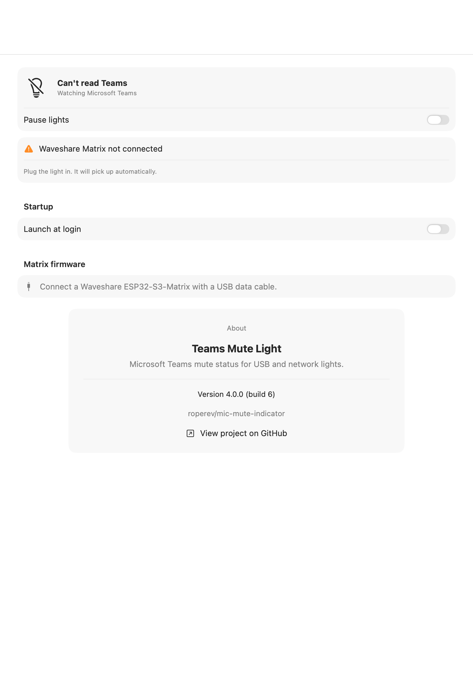
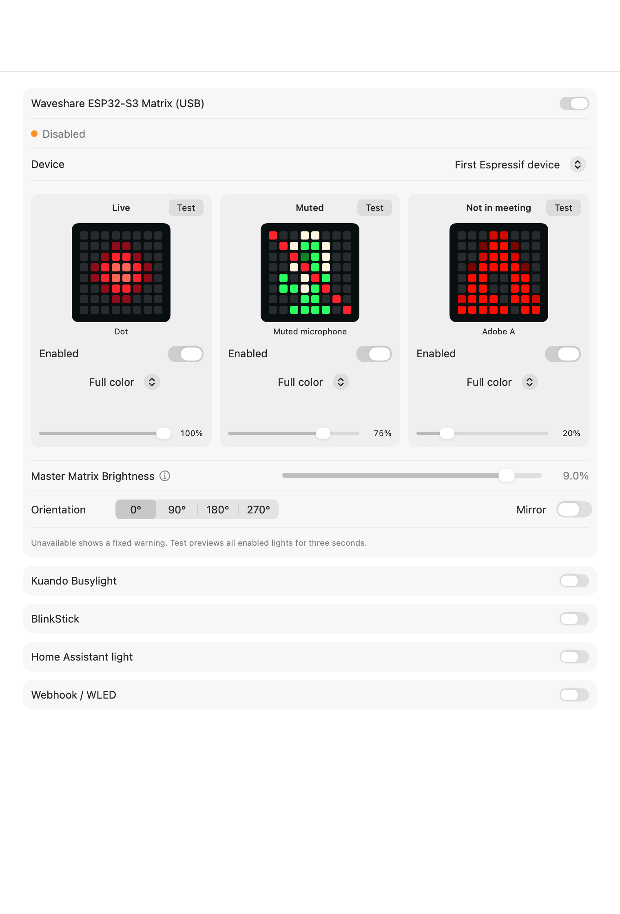
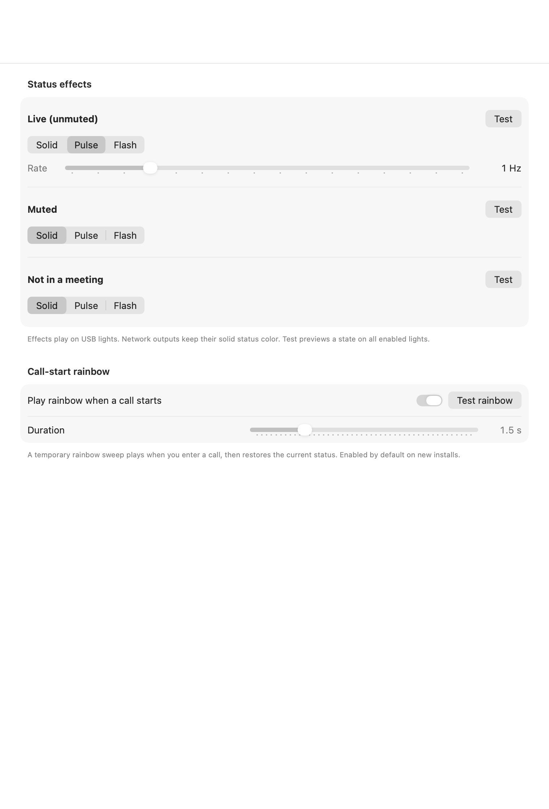
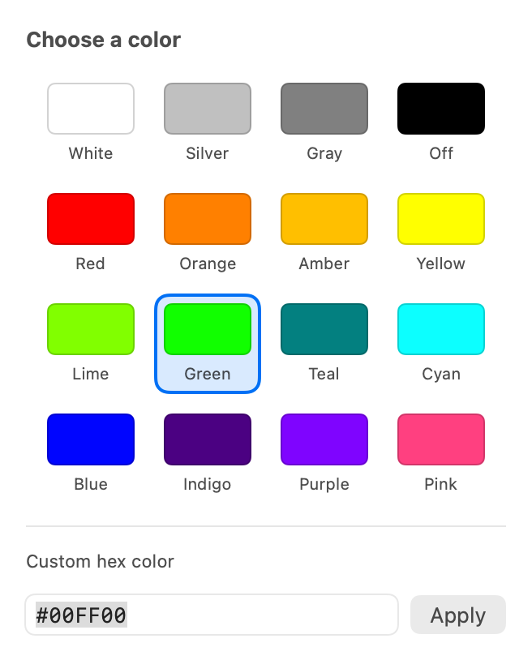

# Teams Mute Light v4.0.0

A macOS menu-bar app that shows **Microsoft Teams mute state**, not just microphone activity, on USB lights, an 8x8 RGB matrix, or a Home Assistant light.

- **Detection:** Teams' local API or the meeting mic button via macOS Accessibility.
- **Outputs:** Waveshare ESP32-S3 Matrix, Kuando Busylight, BlinkStick, Home Assistant, webhook, and WLED. Enable any combination.
- **Controls:** per-output colors/brightness, device selection, effects, launch at login, pause, and previews.

[Release notes](CHANGELOG.md) · [Matrix setup and protocol](MATRIX.md)

**New in v4.0.0:** redesigned Settings and an app-contained firmware installer/restore workflow for Waveshare ESP32-S3-Matrix. Existing light settings are preserved.

## Screenshots

Current v4.0.0 Settings, rendered from the app's SwiftUI views with isolated sample settings. Device/status details depend on your connected hardware.

| General | Lights |
|---|---|
|  |  |

| Effects | Advanced |
|---|---|
|  |  |

<details>
<summary>Color picker</summary>



</details>

Regenerate these images on macOS with `bash scripts/generate-settings-screenshots.sh`. This does not read or change your saved settings or flash any device.

## Install the app and set up a new matrix

The downloadable app targets **Apple Silicon Macs running macOS 14+**. Use an app ZIP from this project's GitHub Releases when published, not GitHub's source-code ZIP. Extract **Teams Mute Light.app**, copy it to Applications, and open it. No Python, Arduino CLI, Homebrew or runtime downloads are needed by the packaged app.

**macOS approval:** this project is locally/self-signed, not Apple-notarized. Gatekeeper can warn or block a downloaded copy. Verify the download source/checksum before allowing it through **System Settings > Privacy & Security > Open Anyway**, when macOS offers that option. Managed Macs may prohibit unnotarized apps. Do not disable Gatekeeper globally. Accessibility permission is still granted separately for reading Teams.

1. Connect the **Waveshare ESP32-S3-Matrix** with a USB data cable. Unlock the Mac and approve USB accessory access if macOS asks.
2. Open **Settings > General > Matrix firmware**. Select the exact board if multiple devices appear.
3. Choose **Inspect firmware**. This resets into its bootloader to read chip identity and firmware evidence; it does not write flash.
4. Choose **Install MicMatrix**, confirm the board model and leave **Back up current firmware** checked. Generic Espressif USB IDs do not identify the Waveshare board model.
5. Leave **Use this matrix for status lights** checked to select and enable this board after flash verification and a healthy MicMatrix/accelerometer handshake.
6. Keep the app open and USB connected until completion. Settings lists the verified original backup's path and **Reveal in Finder**.

Backups default to `~/Library/Application Support/TeamsMuteLight/FirmwareBackups/<device-MAC>/`. The first original is preserved; later backups are separate snapshots. If you deliberately uncheck backup, a **second destructive confirmation** is required: existing flash contents will be destroyed, and there is no return to the original without an existing valid backup.

**Restore before retiring the board:** in General, choose **Flash back to original firmware…**, review the selected board and backup, and confirm. This writes its captured complete flash image back to the board and disables that board's matrix output; the app and other lights keep running. **Choose an existing backup file…** only registers a complete same-board backup from disk—it does not flash the board. The first registered original is preserved; additional files are added separately. Quitting or deleting the Mac app does **not** restore firmware or delete backups. The app does not ship a universal stock firmware image.

Normal Quit/relaunch/cancellation are blocked during erase, write and verification, and idle sleep is inhibited. Force Quit, unplugging and power loss cannot be prevented; an interrupted operation may require **BOOT/RESET** recovery. See the [matrix installation, backup and recovery guide](MATRIX.md#install-or-restore-from-the-app).

## Build and run

Requires **macOS 14+**, Xcode or Command Line Tools (`xcode-select --install`), and Microsoft Teams. New Teams supports the local API; Classic Teams is supported through Accessibility.

```bash
cd mic-mute-indicator
chmod +x build.sh scripts/*.sh
./scripts/create-signing-cert.sh   # once: stable signing preserves Accessibility grants
bash tools/firmware/build.sh       # developer-only: build firmware + frozen helper + source notices
./build.sh
# Quit any running copy before replacing the app.
osascript -e 'tell application "Teams Mute Light" to quit'
ditto "build/Teams Mute Light.app" "/Applications/Teams Mute Light.app"
codesign --verify --strict "/Applications/Teams Mute Light.app"
open "/Applications/Teams Mute Light.app"
```

Developer firmware preparation needs Arduino CLI and a Python build environment (validated with Python 3.13.16) and downloads pinned dependencies; see [helper tooling](tools/firmware/). These are **build-machine** requirements, never end-user requirements. `bash scripts/package-app.sh` assembles a locally signed arm64 download ZIP and checksum after preparation; it does not upload or publish it. Third-party notices and corresponding source are included under the app's firmware resources.

Open **Settings...** from the status beacon in the menu bar.

Check **General > About > Version** for **4.0.0 (build 6)** to confirm the updated app is running. Settings retains its original SwiftUI-managed appearance with a fixed 760 x 1030-point content area. The window is not resizable; tabs remain scrollable when their content exceeds the window.

| State | Existing menu-bar symbol | Color |
|---|---|---|
| Live | Beacon with rays | Pulsing red |
| Muted | Filled beacon | Green |
| Not in a call | Outline beacon | White |
| Unavailable | Slashed lightbulb | White |
| Paused | Pause circle | White |

Menu-bar color follows actual detection, not temporary previews. Its 1.5-second red pulse uses a bounded timer, independent of light-output settings.

### Settings

- **General:** detected status, **Pause lights**, permission fixes, launch at login, matrix firmware installation/backups/restore, and project/version information with a GitHub link.
- **Lights:** fixed order of Matrix, Kuando, BlinkStick, Home Assistant and Webhook/WLED. Matrix cards put Test beside each state title, with an Enabled switch, color mode and aligned brightness controls.
- **Effects:** Solid/Pulse/Flash controls and Test for each state. This is the only Settings page with the call-start rainbow toggle, duration and manual Test; automatic playback remains on by default for new installs.
- **Advanced:** detection mode, explained Teams microphone-button matching, an Update interval dropdown, and selectable diagnostics/event log.

All color controls open a 16-swatch popover, including black/Off. Choose a swatch to apply it immediately, or enter a six-digit `RRGGBB` / `#RRGGBB` value and choose Apply or press Return. Invalid hex shows an error without changing the saved color; closing the popover discards unapplied text.

Accessibility Update interval choices are 0.2, 0.3, 0.5, 1, 2 and 5 seconds (0.5 by default). Existing custom intervals remain visible without being reset. Shorter intervals trade more frequent checks for faster response; the paired Teams API is push-based and does not use this setting.

## Hardware and outputs

### Output overview

| Output | Connection | Setup |
|---|---|---|
| **Waveshare ESP32-S3 Matrix** | Native USB-C serial; custom MicMatrix firmware | [Matrix guide](MATRIX.md) |
| **Kuando Busylight** | USB HID; VID `27BB`, legacy `04D8:F848` | Quit Kuando software before enabling this output |
| **BlinkStick** | USB HID; `20A0:41E5` | Select device and LED count; Nano has two LEDs |
| **Home Assistant** | Local HTTP API | Set base URL, entity ID and Keychain-backed token |
| **Webhook / WLED** | HTTP POST | Set URL and Generic or WLED format |

### Matrix: visual status display

The matrix supports independent RGB pixels, automatic upright orientation, a 16-choice visual gallery, and three adjacent status cards. Unavailable uses a fixed warning rather than an editable fourth card.

**Fresh-install defaults (v4.0.0; unchanged from v2.0.1)**

Master brightness: **9.0%**, with a **1-10%** slider range. Matrix output remains opt-in.

| Status | Graphic | Palette | Relative brightness | Effect |
|---|---|---|---|---|
| **Live** | Red Dot | Full color | **100%** | Pulse, **1 Hz** |
| **Muted** | Green Muted microphone with red slash | Full color | **75%** | Solid |
| **Not in meeting** | Red Adobe A | Full color | **20%** | Solid |
| **Unavailable** | Red warning ! with yellow accents | Fixed full color | Master brightness | No editable card |

The three editable statuses use full palette intensity; relative sliders supply the dimming. Existing saved settings are **not changed**. Legacy settings without relative brightness retain 100% multipliers.

> **Brightness and heat:** The 9% default is intended for a light-diffusing case. Start lower, such as 2%, on exposed LEDs. Firmware caps channel output at `25/255` (9.8%); this is a precaution, **not a thermal guarantee**. Avoid sustained full-panel white and unplug unusually hot hardware.

- **Choose artwork:** click the hero preview. Full color (formerly Original palette), Tint artwork, and Single color are available. Enabled, black/Off and 0% brightness can hide a status without changing its icon. Test previews that state on all enabled outputs for three seconds.
- **Master brightness:** hover over the information icon beside Master Matrix Brightness for relative-level behavior, low-level LED precision and safety guidance.
- **Preview appearance:** hero thumbnails show normalized color intensity, not physical brightness. Gamma-2.2 correction is applied only to LED output.
- **Call-start effect:** a full-panel rainbow flow temporarily replaces the icon, then restores the status. It uses master brightness, not the relative status multiplier.
- **Overnight behavior:** with no Live/Muted call, lock, inactive user session, display sleep, or system sleep blanks the matrix. It restores when you return. Other outputs are unchanged.
- **Orientation:** gravity keeps artwork upright. The always-visible segmented control adds a 0/90/180/270-degree offset; Mirror flips the artwork horizontally before orientation mapping.


The embedded gallery is **static** to keep browsing responsive. [Open the animated gallery on demand](Resources/matrix-gallery-animated.svg) to see AFK cycle A/F/K and Shrug scroll `¯\_(ツ)_/¯` right-to-left. The animated version can be GPU-intensive; close it when finished. Each board has exactly 64 simulated LEDs; glow is illustrative.

With **MicMatrix v4**, the board renders pulse, flash, AFK and Shrug locally. USB sends a preset when state/settings change and a small once-per-second keepalive, rather than streaming those animations. Disabled/blanked output has no matrix timer or discovery activity. The app still supports v3 firmware through frame streaming; temporary full-panel rainbow effects also remain streamed.

For flashing, safety, CLI demos, calibration, the v4 USB protocol and measured performance, see the [matrix guide](MATRIX.md).

### Kuando and BlinkStick: USB status lights

- **Companion use:** leave Kuando running on its own software for meeting/presence and let Matrix, BlinkStick, HA or WLED show mute state. Disable this app's Kuando output.
- **Kuando-only:** quit Kuando's software and let this app drive the Busylight. The Kuando-only preset uses green for available, amber for muted, and red for Live.
- **BlinkStick:** select the device and number of LEDs. Nano uses two; other models may have more.

Test with the relevant app output disabled:

```bash
APP="/Applications/Teams Mute Light.app/Contents/MacOS/TeamsMuteLight"
"$APP" --cli devices
"$APP" --cli cycle kuando
"$APP" --cli kuando "#FF0000" 5
"$APP" --cli blinkstick "#00FF00" 5 2
```

### Home Assistant, webhook and WLED

| Mode | Request | Configuration |
|---|---|---|
| **Home Assistant** | `POST /api/services/light/turn_on` or `turn_off` | Base URL, RGB light entity, long-lived token in Keychain |
| **Generic webhook** | `POST {"state","color","r","g","b","brightness"}` | Node-RED, automations, or your own controller |
| **WLED webhook** | `POST /json/state` | WLED host URL and WLED format |

An ESP32 running WLED is a straightforward DIY alternative. Any RGB Home Assistant entity, such as Hue, Zigbee or ESPHome, also works. A BlinkStick-compatible ATtiny85/V-USB device can use the BlinkStick output.

## Teams detection

### Local API

1. In Teams, open **Settings > Privacy > Third-party app API > Manage API** and enable the API.
2. Join a meeting; a solo "Meet now" is enough.
3. Choose **Pair with Teams (toggles mute once)** from this app's menu and approve Teams' device prompt.
4. The token stays in Keychain. Teams then pushes `isMuted` / `isInMeeting`.

If the API setting is missing, your Teams build or organization may not expose it. Choose **Accessibility only** in Advanced. Auto mode uses the API when paired and otherwise falls back to Accessibility. `lsof -nP -iTCP:8124 -sTCP:LISTEN` checks whether Teams' API port is listening.

### Accessibility

Grant **System Settings > Privacy & Security > Accessibility** to the bundled app. The app reads the meeting mic button, preferring DOM ID `microphone-button`:

- **"Unmute"** means currently muted.
- **"Mute"** means currently unmuted.

Edit the label regexes in Advanced for other languages or changed Teams labels. The default poll interval is 0.5 seconds; full-tree searches are throttled outside meetings.

```bash
"$APP" --cli watch      # join a meeting and toggle mute
"$APP" --cli ax-dump    # inspect button labels; terminal needs Accessibility permission
```

**Unavailable** means unknown mic detection, not Teams Busy/Away/Do not disturb. It can occur without Accessibility permission, with an unpaired API-only configuration, or when a meeting is reported without mute state. Teams not running or no meeting mic button normally means Not in meeting.

## Upgrade and validation

- Install with the same signing identity to retain Accessibility grants.
- Saved output enables, colors, icons, effects, master brightness and relative levels remain unchanged. Fresh defaults apply only to new settings.
- For local matrix animation, install app v3.0.0 or newer before flashing MicMatrix v4 (`MATRIX 4 8 8 25 PRESET1`). Older app releases do not recognize that handshake. Existing MicMatrix v3 (`MATRIX 3 8 8 25`) remains supported through frame streaming; earlier protocols/ceilings require an upgrade. Use the packaged installer and default backup; see the [matrix guide](MATRIX.md#install-or-restore-from-the-app).
- Shield selections display Adobe A; saved `shield` and `off` identifiers remain supported. Off is no longer in the chooser; Warning replaces it.
- Unavailable overrides old Unavailable icon/color/level choices with a fixed warning. Lock/sleep blanking still applies.
- App release **4.0.0**, Teams API protocol **2.0.0**, and matrix wire protocol **v4** (with v3 compatibility) are separate version numbers. Existing MicMatrix users do not need to reflash solely for the Settings changes.

```bash
bash scripts/test-matrix.sh
bash scripts/generate-matrix-gallery.sh
bash build.sh
```

The 17 standalone Swift tests and C++ tests work with Command Line Tools alone. They cover defaults/migration, artwork, gamma, brightness, animations, lock/sleep policy, menu-bar colors, protocol parsing, orientation and lease rollover. Another 7,344 byte-exact comparisons verify Swift/firmware rendering parity. [Physical USB tests and performance benchmarks](MATRIX.md#validation) are optional.

Run `bash scripts/test-settings-window.sh` in a logged-in macOS desktop session to check hex-entry validation, all four tabs, expanded Advanced details, mixed matrix color modes, Off, the color-popover layout, fixed 760 x 1030-point content and settings preservation. It uses isolated in-memory settings without sending to devices. Add `--capture` for layout PNGs under `build/`, and `--light` for light appearance. These checks do not automate mouse or keyboard interaction.

## Troubleshooting

| Symptom | Check |
|---|---|
| Busylight flickers or changes on its own | Quit Kuando software or disable this app's Kuando output |
| USB output disconnects/goes dark | Device selection, cable, competing app, and Advanced log |
| Matrix rejects firmware | Flash the matching version; close serial monitors |
| Matrix dark after lock/sleep | Expected outside a call; unlock and wake to restore |
| Very dim pixels disappear or change color | Low PWM precision; raise brightness slightly within the limit |
| Teams API not connected | Teams/API availability; use Accessibility or Auto |
| No meeting mic button | Run AX dump during a meeting and update regexes |
| Accessibility still denied | Remove stale app entries, grant the bundled `.app`, and relaunch |
| Home Assistant HTTP blocked | Use HTTPS, an IP address, or a `.local` hostname |

For a stale Accessibility grant, remove all Teams Mute Light entries in System Settings, then grant the installed `.app` again. Do not add the inner executable. Last resort: `tccutil reset Accessibility com.eroper.TeamsMuteLight`.

## Project map

- [Sources/TeamsMuteLight](Sources/TeamsMuteLight): controller, detection, USB/network outputs, menu bar and Settings.
- [MatrixProtocol.swift](Sources/TeamsMuteLight/Outputs/MatrixProtocol.swift): artwork, animations, gamma, matrix settings and wire encoding.
- [firmware/MicMatrix](firmware/MicMatrix): pinned Arduino profile, renderer, protocol and orientation.
- [Tests](Tests) and [firmware/tests](firmware/tests): Swift/C++ regressions.
- [scripts](scripts): signing, gallery generation and hardware validation.
- [Resources](Resources): bundle metadata and generated gallery.

`swift build && .build/debug/TeamsMuteLight` runs unbundled for development; firmware installation requires the complete packaged app and reports missing resources in an unbundled build. Launch at login requires the installed app bundle. Build products and firmware backups are excluded from Git.

## References

[Waveshare board documentation](https://docs.waveshare.com/ESP32-S3-Matrix) · [Teams API notes](https://github.com/svrooij/teams-monitor) · [Kuando HID reference](https://github.com/yaddran/busylight) · [BeezyLight](https://github.com/leonardodino/BeezyLight)
