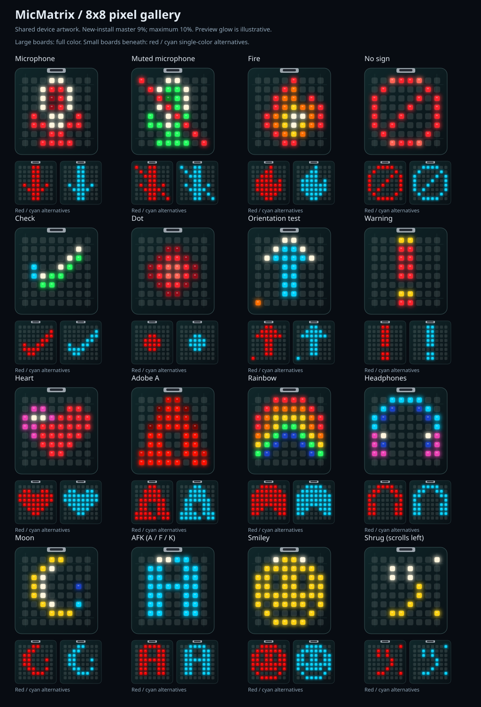

# Teams Mute Light v2.0.1

A macOS menu-bar app that shows **Microsoft Teams mute state**, not just microphone activity, on USB lights, an 8x8 RGB matrix, or a Home Assistant light.

- **Detection:** Teams' local API or the meeting mic button via macOS Accessibility.
- **Outputs:** Waveshare ESP32-S3 Matrix, Kuando Busylight, BlinkStick, Home Assistant, webhook, and WLED. Enable any combination.
- **Controls:** per-output colors/brightness, device selection, effects, launch at login, pause, and previews.

[Release notes](CHANGELOG.md) · [Matrix setup and protocol](MATRIX.md)

## Build and run

Requires **macOS 14+**, Xcode or Command Line Tools (`xcode-select --install`), and Microsoft Teams. New Teams supports the local API; Classic Teams is supported through Accessibility.

```bash
cd mic-mute-indicator
chmod +x build.sh scripts/*.sh
./scripts/create-signing-cert.sh   # once: stable signing preserves Accessibility grants
./build.sh
# Quit any running copy before replacing the app.
osascript -e 'tell application "Teams Mute Light" to quit'
ditto "build/Teams Mute Light.app" "/Applications/Teams Mute Light.app"
codesign --verify --strict "/Applications/Teams Mute Light.app"
open "/Applications/Teams Mute Light.app"
```

Open **Settings...** from the status beacon in the menu bar.

| State | Existing menu-bar symbol | Color |
|---|---|---|
| Live | Beacon with rays | Pulsing red |
| Muted | Filled beacon | Green |
| Not in a call | Outline beacon | White |
| Unavailable | Slashed lightbulb | White |
| Paused | Pause circle | White |

Menu-bar color follows actual detection, not temporary previews. Its 1.5-second red pulse uses a bounded timer, independent of light-output settings.

### Settings

- **General:** status, permission fixes, launch at login, version.
- **Lights:** output toggles, devices, palettes and brightness.
- **Effects:** per-state pulse/flash and the call-start rainbow.
- **Advanced:** detection mode, mic-button matching, diagnostics and log.

## Hardware and outputs

### Output overview

| Output | Connection | Setup |
|---|---|---|
| **Waveshare ESP32-S3 Matrix** | Native USB-C serial; custom MicMatrix firmware | [Matrix guide](MATRIX.md) |
| **Kuando Busylight** | USB HID; VID `27BB`, legacy `04D8:F848` | Quit Kuando software before enabling this output |
| **BlinkStick** | USB HID; `20A0:41E5` | Select device and LED count; Nano has two LEDs |
| **Home Assistant** | Local HTTP API | Set base URL, entity ID and Keychain-backed token |
| **Webhook / WLED** | HTTP POST | Set URL and Generic or WLED format |

### Matrix: visual status display

The matrix supports independent RGB pixels, automatic upright orientation, a 16-choice visual gallery, and three adjacent status cards. Unavailable uses a fixed warning rather than an editable fourth card.

**Fresh-install defaults (v2.0.1)**

Master brightness: **9.0%**, with a **1-10%** slider range. Matrix output remains opt-in.

| Status | Graphic | Palette | Relative brightness | Effect |
|---|---|---|---|---|
| **Live** | Red Dot | Original palette | **100%** | Pulse, **1 Hz** |
| **Muted** | Green Muted microphone with red slash | Original palette | **75%** | Solid |
| **Not in meeting** | Red Adobe A | Original palette | **20%** | Solid |
| **Unavailable** | Red warning ! with yellow accents | Fixed original palette | Master brightness | No editable card |

The three editable statuses use full palette intensity; relative sliders supply the dimming. Existing saved settings are **not changed**. Legacy settings without relative brightness retain 100% multipliers.

> **Brightness and heat:** The 9% default is intended for a light-diffusing case. Start lower, such as 2%, on exposed LEDs. Firmware caps channel output at `25/255` (9.8%); this is a precaution, **not a thermal guarantee**. Avoid sustained full-panel white and unplug unusually hot hardware.

- **Choose artwork:** click the hero preview. Original palette, Tint artwork, and Single color are available. Display and 0% relative brightness turn a status off.
- **Preview appearance:** hero thumbnails show normalized color intensity, not physical brightness. Gamma-2.2 correction is applied only to transmitted LED colors.
- **Call-start effect:** a full-panel rainbow flow temporarily replaces the icon, then restores the status. It uses master brightness, not the relative status multiplier.
- **Overnight behavior:** with no Live/Muted call, lock, inactive user session, display sleep, or system sleep blanks the matrix. It restores when you return. Other outputs are unchanged.
- **Orientation:** gravity keeps artwork upright; offset/mirror options are in the collapsed calibration disclosure.



The embedded gallery is **static** to keep browsing responsive. [Open the animated gallery on demand](Resources/matrix-gallery-animated.svg) to see AFK cycle A/F/K and Shrug scroll `¯\_(ツ)_/¯` right-to-left. The animated version can be GPU-intensive; close it when finished. Each board has exactly 64 simulated LEDs; glow is illustrative.

For flashing, safety, CLI demos, calibration and the v3 USB protocol, see the [matrix guide](MATRIX.md).

### Kuando and BlinkStick: USB status lights

- **Companion use:** leave Kuando running on its own software for meeting/presence and let Matrix, BlinkStick, HA or WLED show mute state. Disable this app's Kuando output.
- **Kuando-only:** quit Kuando's software and let this app drive the Busylight. The Kuando-only preset uses green for available, amber for muted, and red for Live.
- **BlinkStick:** select the device and number of LEDs. Nano uses two; other models may have more.

Test with the relevant app output disabled:

```bash
APP="/Applications/Teams Mute Light.app/Contents/MacOS/TeamsMuteLight"
"$APP" --cli devices
"$APP" --cli cycle kuando
"$APP" --cli kuando "#FF0000" 5
"$APP" --cli blinkstick "#00FF00" 5 2
```

### Home Assistant, webhook and WLED

| Mode | Request | Configuration |
|---|---|---|
| **Home Assistant** | `POST /api/services/light/turn_on` or `turn_off` | Base URL, RGB light entity, long-lived token in Keychain |
| **Generic webhook** | `POST {"state","color","r","g","b","brightness"}` | Node-RED, automations, or your own controller |
| **WLED webhook** | `POST /json/state` | WLED host URL and WLED format |

An ESP32 running WLED is a straightforward DIY alternative. Any RGB Home Assistant entity, such as Hue, Zigbee or ESPHome, also works. A BlinkStick-compatible ATtiny85/V-USB device can use the BlinkStick output.

## Teams detection

### Local API

1. In Teams, open **Settings > Privacy > Third-party app API > Manage API** and enable the API.
2. Join a meeting; a solo "Meet now" is enough.
3. Choose **Pair with Teams (toggles mute once)** from this app's menu and approve Teams' device prompt.
4. The token stays in Keychain. Teams then pushes `isMuted` / `isInMeeting`.

If the API setting is missing, your Teams build or organization may not expose it. Choose **Accessibility only** in Advanced. Auto mode uses the API when paired and otherwise falls back to Accessibility. `lsof -nP -iTCP:8124 -sTCP:LISTEN` checks whether Teams' API port is listening.

### Accessibility

Grant **System Settings > Privacy & Security > Accessibility** to the bundled app. The app reads the meeting mic button, preferring DOM ID `microphone-button`:

- **"Unmute"** means currently muted.
- **"Mute"** means currently unmuted.

Edit the label regexes in Advanced for other languages or changed Teams labels. The default poll interval is 0.5 seconds; full-tree searches are throttled outside meetings.

```bash
"$APP" --cli watch      # join a meeting and toggle mute
"$APP" --cli ax-dump    # inspect button labels; terminal needs Accessibility permission
```

**Unavailable** means unknown mic detection, not Teams Busy/Away/Do not disturb. It can occur without Accessibility permission, with an unpaired API-only configuration, or when a meeting is reported without mute state. Teams not running or no meeting mic button normally means Not in meeting.

## Upgrade and validation

- Install with the same signing identity to retain Accessibility grants.
- Saved output enables, colors, icons, effects, master brightness and relative levels remain unchanged. Fresh defaults apply only to new settings.
- The matrix requires `MATRIX 3 8 8 25`; flash matching firmware if upgrading from an older protocol/ceiling.
- Shield selections display Adobe A; saved `shield` and `off` identifiers remain supported. Off is no longer in the chooser; Warning replaces it.
- Unavailable overrides old Unavailable icon/color/level choices with a fixed warning. Lock/sleep blanking still applies.
- App release **2.0.1**, Teams API protocol **2.0.0**, and matrix wire protocol **v3** are separate version numbers.

```bash
bash scripts/test-matrix.sh
bash scripts/generate-matrix-gallery.sh
bash build.sh
```

The 16 standalone Swift tests and C++ tests work with Command Line Tools alone. They cover defaults/migration, artwork, gamma, brightness, animations, lock/sleep policy, menu-bar colors, protocol parsing and orientation. [Physical USB tests](MATRIX.md#validation) are optional.

## Troubleshooting

| Symptom | Check |
|---|---|
| Busylight flickers or changes on its own | Quit Kuando software or disable this app's Kuando output |
| USB output disconnects/goes dark | Device selection, cable, competing app, and Advanced log |
| Matrix rejects firmware | Flash the matching version; close serial monitors |
| Matrix dark after lock/sleep | Expected outside a call; unlock and wake to restore |
| Very dim pixels disappear or change color | Low PWM precision; raise brightness slightly within the limit |
| Teams API not connected | Teams/API availability; use Accessibility or Auto |
| No meeting mic button | Run AX dump during a meeting and update regexes |
| Accessibility still denied | Remove stale app entries, grant the bundled `.app`, and relaunch |
| Home Assistant HTTP blocked | Use HTTPS, an IP address, or a `.local` hostname |

For a stale Accessibility grant, remove all Teams Mute Light entries in System Settings, then grant the installed `.app` again. Do not add the inner executable. Last resort: `tccutil reset Accessibility com.eroper.TeamsMuteLight`.

## Project map

- [Sources/TeamsMuteLight](Sources/TeamsMuteLight): controller, detection, USB/network outputs, menu bar and Settings.
- [MatrixProtocol.swift](Sources/TeamsMuteLight/Outputs/MatrixProtocol.swift): artwork, animations, gamma, matrix settings and wire encoding.
- [firmware/MicMatrix](firmware/MicMatrix): pinned Arduino profile, renderer, protocol and orientation.
- [Tests](Tests) and [firmware/tests](firmware/tests): Swift/C++ regressions.
- [scripts](scripts): signing, gallery generation and hardware validation.
- [Resources](Resources): bundle metadata and generated gallery.

`swift build && .build/debug/TeamsMuteLight` runs unbundled for development. Launch at login requires the installed app bundle. Build products and firmware backups are excluded from Git.

## References

[Waveshare board documentation](https://docs.waveshare.com/ESP32-S3-Matrix) · [Teams API notes](https://github.com/svrooij/teams-monitor) · [Kuando HID reference](https://github.com/yaddran/busylight) · [BeezyLight](https://github.com/leonardodino/BeezyLight)
